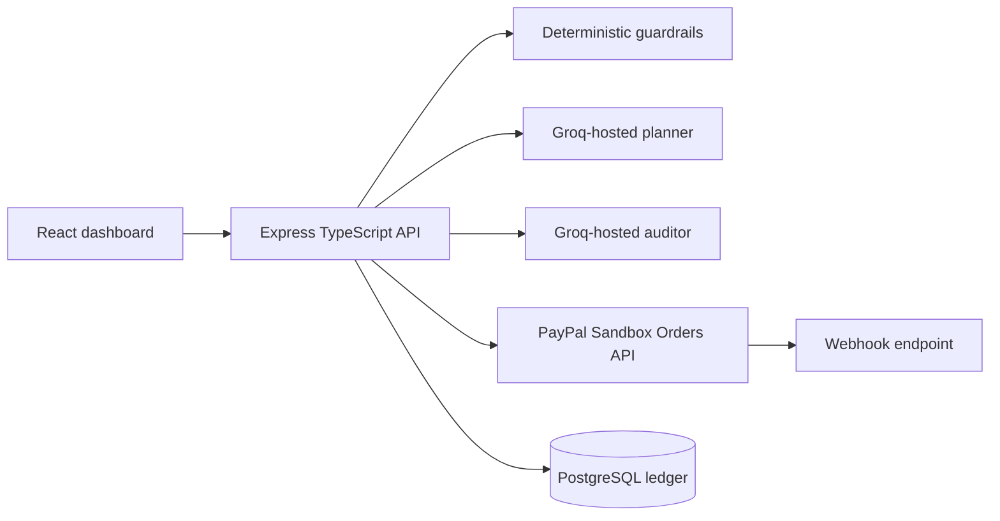

# AgentWallet

AgentWallet is a PayPal Sandbox spending-control layer for AI purchases. A Groq-hosted planner proposes a purchase, deterministic guardrails enforce the user's budget and allowlists, and a separate Groq-hosted auditor checks relevance and prompt injection before approval.

## One-command demo

1. Copy `backend/.env.example` to `backend/.env` and set `GROQ_API_KEY`, `PAYPAL_CLIENT_ID`, and `PAYPAL_CLIENT_SECRET`.
2. Run:

```powershell
cd backend; npm install; npm run dev
cd ..\frontend; npm install; npm run dev
```

Open `http://localhost:5173`. Set `DATABASE_URL` and apply `backend/db-schema.sql` for PostgreSQL-backed ledger, budget, and confirmed-payment analytics. MongoDB remains supported as a local fallback. PayPal calls fail clearly until Sandbox credentials are configured.

## Architecture



The current starter API is Express/TypeScript and keeps all secrets server-side. The attack demo product contains an instruction injection and is rejected by the auditor or policy.

## PayPal webhook deployment

Deploy the backend publicly, then register this URL in the PayPal Developer Dashboard:

`https://YOUR_BACKEND_HOST/api/webhooks/paypal`

Subscribe to `PAYMENT.CAPTURE.COMPLETED` and `PAYMENT.CAPTURE.DENIED`. Set `PAYPAL_WEBHOOK_ID` after PayPal creates the webhook. The endpoint is intentionally available before that ID exists so deployment and PayPal registration can happen in either order.
