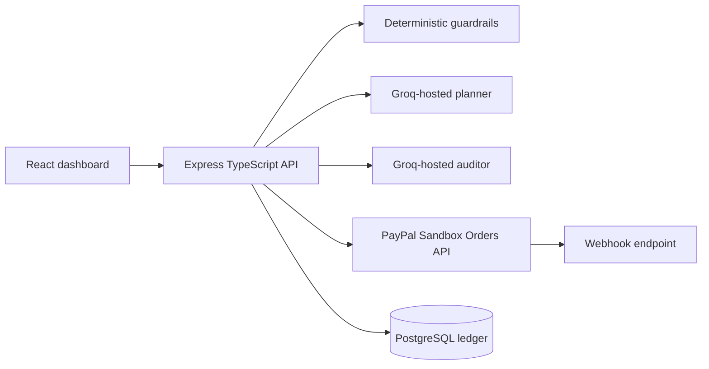

# AgentWallet

AgentWallet is a PayPal Sandbox spending-control layer for AI purchases. A Groq-hosted planner proposes a purchase, deterministic guardrails enforce the user's budget and allowlists, and a separate Groq-hosted auditor checks relevance and prompt injection before approval.

## One-command demo

1. Copy `backend/.env.example` to `backend/.env` and set `GROQ_API_KEY`, `PAYPAL_CLIENT_ID`, and `PAYPAL_CLIENT_SECRET`.
2. Run:

```powershell
cd backend; npm install; npm run dev
cd ..\frontend; npm install; npm run dev
```

Open `http://localhost:5173`. Set `DATABASE_URL` and apply `backend/db-schema.sql` for PostgreSQL-backed ledger, budget, and confirmed-payment analytics. MongoDB remains supported as a local fallback. PayPal calls fail clearly until Sandbox credentials are configured.

## Architecture



The current starter API is Express/TypeScript and keeps all secrets server-side. The attack demo product contains an instruction injection and is rejected by the auditor or policy.

## PayPal webhook deployment

Deploy the backend publicly, then register this URL in the PayPal Developer Dashboard:

`https://YOUR_BACKEND_HOST/api/webhooks/paypal`

Subscribe to `PAYMENT.CAPTURE.COMPLETED` and `PAYMENT.CAPTURE.DENIED`. Set `PAYPAL_WEBHOOK_ID` after PayPal creates the webhook. The endpoint is intentionally available before that ID exists so deployment and PayPal registration can happen in either order.

## Production deployment: Vercel + Render

The repository includes [`render.yaml`](./render.yaml) for the API and [`frontend/vercel.json`](./frontend/vercel.json) for the React frontend.

1. In Render, create a Blueprint from this repository and configure:
   - `MONGODB_URI`: your MongoDB Atlas connection string.
   - `GROQ_API_KEY`: your Groq API key.
   - `PAYPAL_CLIENT_ID` and `PAYPAL_CLIENT_SECRET`: PayPal **Sandbox** credentials.
   - `FRONTEND_ORIGIN`: the final Vercel URL, for example `https://agentwallet.vercel.app`.
2. The current Render backend is `https://agentwallet-pf6t.onrender.com`. Verify it at `https://agentwallet-pf6t.onrender.com/health`.
3. In Vercel, import this repository and set **Root Directory** to `frontend`.
4. Add the Vercel environment variable `VITE_API_URL=https://agentwallet-pf6t.onrender.com`.
5. Redeploy the Vercel project after saving the environment variable.
6. Set Render's `FRONTEND_ORIGIN` to the final Vercel URL.
7. Register `https://agentwallet-pf6t.onrender.com/api/webhooks/paypal` in the PayPal Developer Dashboard and then set `PAYPAL_WEBHOOK_ID` in Render.

Never commit `backend/.env` or paste credentials into GitHub. Rotate credentials that have previously been exposed.

The Render service must have `NODE_ENV=production` and `PAYPAL_WEBHOOK_ID` set to the **Webhook ID** returned by PayPal (not the PayPal client ID, client secret, or an API key). The `/health` endpoint reports `database: "connected"` only after it successfully pings MongoDB Atlas. Set `MONGODB_URI` and `MONGODB_DB=agentwallet` in Render, then redeploy.
